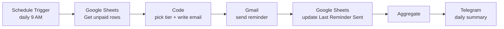

# Invoice Payment Reminder Bot (n8n)

An n8n workflow that checks your unpaid invoices every morning and automatically emails clients a reminder. The tone gets firmer the longer an invoice is overdue, and nobody gets spammed.

   

> Add a screenshot or GIF of your workflow canvas here: `docs/workflow.png`

---

## What it does

Every day at 9:00 AM the workflow:

1. Reads all invoices marked **Unpaid** from a Google Sheet
2. Calculates how many days each invoice is overdue
3. Picks a reminder tier automatically
4. Skips invoices that were already reminded in the last 3 days
5. Sends a personalized email through Gmail
6. Records the reminder date in the sheet, so the 3-day rule works
7. Sends you a daily summary on Telegram (optional)

### Reminder tiers

| Days overdue | Tier | Tone |
|---|---|---|
| Not yet due | skipped | no email |
| 1-6 days | `friendly` | casual nudge, "ignore if already paid" |
| 7-14 days | `firm` | clear request to pay this week |
| 15+ days | `final` | final notice, asks for immediate payment or contact |

---

## Workflow overview



| Node | Purpose |
|---|---|
| Schedule Trigger | Runs every day at 9:00 AM |
| Google Sheets (Get row(s)) | Fetches rows where `Status = Unpaid` |
| Code (JavaScript) | Computes days overdue, applies the 3-day rule, chooses tier, builds subject and body |
| Gmail (Send a message) | Sends the reminder to the client |
| Google Sheets (Update row) | Writes today's date to `Last Reminder Sent` |
| Aggregate + Telegram | Sends you a summary of how many reminders went out |

---

## Prerequisites

- An [n8n](https://n8n.io) instance (cloud or self-hosted)
- A Google account
- A Google Cloud project with the **Google Sheets API**, **Google Drive API** and **Gmail API** enabled
- An OAuth 2.0 client (type: Web application) with this redirect URI (self-hosted example):
  `http://localhost:5678/rest/oauth2-credential/callback`
- *(Optional)* A Telegram bot token from [@BotFather](https://t.me/BotFather) and your chat ID

---

## Setup

### 1. Prepare the Google Sheet

Import `sample-data/Invoice_Reminder_Test_Data.xlsx` into Google Sheets (**File → Import → Upload**), or create a sheet named **Invoices** with these exact headers in row 1:

| Invoice ID | Client Name | Client Email | Amount | Due Date | Status | Last Reminder Sent |
|---|---|---|---|---|---|---|

- `Due Date` and `Last Reminder Sent` use the `yyyy-mm-dd` format.
- `Status` is either `Unpaid` or `Paid`.
- The workflow depends on these exact header names, so don't rename them.

For testing, replace the placeholder `yourname` in the sample emails with your own Gmail username. Addresses like `yourname+client01@gmail.com` all arrive in your own inbox.

### 2. Connect your credentials in n8n

Create credentials for **Google Sheets OAuth2**, **Gmail OAuth2** and, optionally, **Telegram**.

### 3. Build or import the workflow

Add the nodes in the order shown above, or import your exported workflow JSON (`workflow/invoice-reminder-bot.json`) through **Workflow menu → Import from file**.

**Schedule Trigger**
- Trigger Interval: `Days`, Days Between Triggers: `1`, Trigger at Hour: `9am`, Minute: `0`

**Google Sheets: Get row(s) in sheet**
- Resource: Sheet Within Document, Operation: Get Row(s)
- Document and Sheet: your spreadsheet and the `Invoices` tab
- Filter: Column `Status`, Value `Unpaid`

**Code (JavaScript)**
- Mode: *Run Once for All Items*, Language: JavaScript

```javascript
const today = new Date();
today.setHours(0, 0, 0, 0);
const out = [];

for (const item of $input.all()) {
  const d = item.json;
  const due = new Date(d['Due Date']);
  due.setHours(0, 0, 0, 0);
  const daysOverdue = Math.floor((today - due) / 86400000);

  // Skip if reminded in the last 3 days
  if (d['Last Reminder Sent']) {
    const last = new Date(d['Last Reminder Sent']);
    last.setHours(0, 0, 0, 0);
    if ((today - last) / 86400000 < 3) continue;
  }

  let tier, subject, body;
  const name = d['Client Name'];
  const inv = d['Invoice ID'];
  const amt = d['Amount'];

  if (daysOverdue >= 15) {
    tier = 'final';
    subject = `Final notice: Invoice ${inv} is ${daysOverdue} days overdue`;
    body = `Hi ${name},\n\nThis is a final reminder that invoice ${inv} for ${amt} is now ${daysOverdue} days overdue. Please arrange payment immediately or contact me today to discuss.\n\nThank you.`;
  } else if (daysOverdue >= 7) {
    tier = 'firm';
    subject = `Overdue: Invoice ${inv}`;
    body = `Hi ${name},\n\nInvoice ${inv} for ${amt} was due ${daysOverdue} days ago and remains unpaid. Please process payment this week.\n\nThanks.`;
  } else if (daysOverdue >= 1) {
    tier = 'friendly';
    subject = `Friendly reminder: Invoice ${inv}`;
    body = `Hi ${name},\n\nJust a quick reminder that invoice ${inv} for ${amt} was due recently. If you've already paid, please ignore this message!\n\nThanks so much.`;
  } else {
    continue; // not overdue yet
  }

  out.push({ json: { ...d, daysOverdue, tier, subject, body } });
}

return out;
```

**Gmail: Send a message**
- To: `{{ $json['Client Email'] }}`
- Subject: `{{ $json.subject }}`
- Email Type: Text
- Message: `{{ $json.body }}`
- Options: turn **Append n8n attribution** off

**Google Sheets: Update row in sheet**
- Column to match on: `Invoice ID`
- Invoice ID: `{{ $('Code in JavaScript').item.json['Invoice ID'] }}`
- Last Reminder Sent: `{{ $now.toFormat('yyyy-MM-dd') }}`

> If your Code node has a different name, use that name inside `$('...')`.

**Aggregate + Telegram** *(optional)*
- Aggregate: *All Item Data*
- Telegram message: `{{ $json.data.length }} payment reminders sent today.`

### 4. Set the timezone

Open **Workflow menu → Settings → Timezone** and choose your own timezone, so "9 AM" means 9 AM for you.

### 5. Test, then publish

1. Add a **Limit** node (Max Items: `3`) before Gmail while testing, to avoid sending dozens of emails at once.
2. Click **Execute workflow** and check your inbox and the sheet.
3. Run it a second time and confirm no duplicates are sent. That proves the 3-day rule works.
4. Remove the Limit node and click **Publish** to activate the schedule.

---

## Sample data and expected results

`sample-data/Invoice_Reminder_Test_Data.xlsx` contains 40 fictional invoices that cover every case:

| Rows | Scenario | Expected result |
|---|---|---|
| 2-11 | Unpaid, never reminded, 1-45 days overdue | Reminder sent |
| 12-16 | Unpaid, last reminded 4-10 days ago | Reminder sent again |
| 17-21 | Unpaid, reminded 0-2 days ago | Skipped (3-day rule) |
| 22-26 | Not yet due | Skipped |
| 27-33 | Status = Paid | Filtered out |
| 34-41 | Mixed unpaid | Mixed |

A first run should read 33 unpaid rows and pass roughly 20 through the Code node.

---

## Customization

- **Change the tiers:** edit the `daysOverdue` thresholds (`15`, `7`, `1`) in the Code node.
- **Change the cooldown:** replace `3` in the "reminded in the last 3 days" check.
- **Change the wording:** edit the `subject` and `body` templates, or add your business name and payment link.
- **Slack instead of Telegram:** swap the Telegram node for a Slack node.
- **Different data source:** replace the Google Sheets nodes with Airtable, Notion, Stripe or QuickBooks.

---

## Troubleshooting

| Problem | Fix |
|---|---|
| `Invalid interval` on Schedule Trigger | Days Between Triggers must be a single number from 1 to 31 |
| Google credential "needs to be reconnected" | Click **Sign in with Google** again and save; add yourself as a test user on the OAuth consent screen |
| Document list won't load | Enable both the Google Sheets API and Google Drive API |
| `redirect_uri_mismatch` | The redirect URI in Google Cloud must match n8n's callback URL exactly |
| Gmail "Invalid To address" | Placeholder emails (`yourname+...`) were not replaced |
| Dates look like numbers (e.g. `46345`) | Set Sheets output formatting to **Formatted** |
| Code node outputs 0 items | Check that `Due Date` is in `yyyy-mm-dd` format and that invoices are actually overdue |
| "Node not found" in an expression | Rename the node reference to match your Code node's actual name |
| Test OAuth tokens expire after 7 days | Publish the OAuth consent screen, or reconnect the credential |

---

## Roadmap

- [ ] Stripe / QuickBooks sync, to stop reminders when an invoice is paid
- [ ] AI-personalized wording per client
- [ ] Error workflow with an Error Trigger that alerts you on failures
- [ ] Weekly report: total outstanding, total collected, worst late payers
- [ ] Support for multiple currencies and payment links

---

## Repository structure

```
.
├── README.md
├── sample-data/
│   └── Invoice_Reminder_Test_Data.xlsx
├── workflow/
│   └── invoice-reminder-bot.json     # export from n8n
└── docs/
    └── workflow.png                  # screenshot of the canvas
```

> **Security note:** never commit credentials, API keys, client secrets or real client emails. Exported n8n workflow JSON does not contain credential secrets, but check the file before publishing.

---

## License

MIT. Use it freely, and a star on the repo is appreciated.

## Author

Built by **[Your Name]**. Available for n8n automation projects.
[LinkedIn](https://linkedin.com/in/your-profile) · [Fiverr/Upwork](https://your-gig-link)
